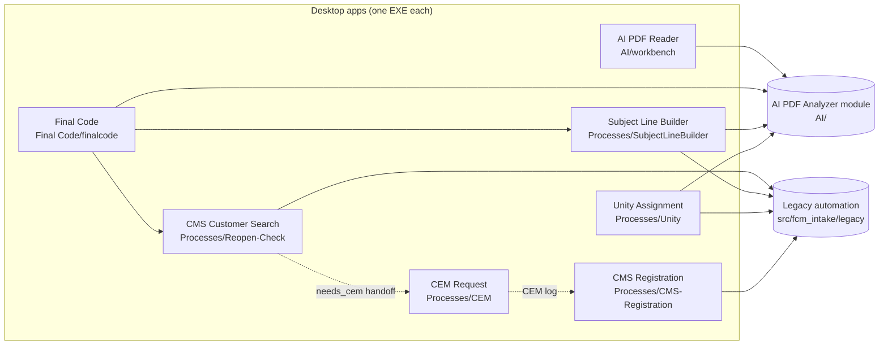

# Code map

Start here for the source code. The BRD ([[brd/INDEX]]) says what the business process *should* do. These notes say what the code *does*, and where. Every file reference was checked against commit `b47ced0`. Line numbers drift, so re-check before you rely on one.

## How the repository is layered



Shared business rules live in `AI/`. Portal automation that hasn't been migrated yet still lives in `src/fcm_intake/legacy/`. Each process in `Processes/` has a `Deploy-Ready/` controller and a `Stand-Alone/` runner, which share one implementation.

**`AI/` is the modular process of the AI PDF Analyzer** (owner-confirmed 2026-10-30). It is the exception to the `Processes/` layout: there is no `Processes/AI-PDF-Analyzer/` folder and no `Deploy-Ready/`/`Stand-Alone/` split. Its stand-alone app is the AI PDF Reader (`AI/workbench`, `AI-FCM-Workbench.exe`), and Final Code embeds the same module. A change in `AI/` reaches both apps, but only after their EXEs are rebuilt. See [[code/ai-shared-modules]].

## Notes

| Note | Covers |
| --- | --- |
| [[code/architecture]] | The end-to-end business flow mapped to apps and code, the process boundaries and the handoffs between them |
| [[code/ai-shared-modules]] | `AI/`, the **AI PDF Analyzer module**: extraction, the referral schema, evidence recovery, review flags, ICD-10-CM checks, classification and persistence |
| [[code/ai-pdf-reader]] | The AI PDF Reader / FCM Workbench: the Analyzer's stand-alone desktop app, plus the older Streamlit/Tk readers |
| [[code/final-code]] | The merged attended chain: capture → extract → review → gate → CMS → Subject Line Builder |
| [[code/cms-customer-search]] | `Processes/Reopen-Check` (CMSCustomerSearch): re-open check and customer validation |
| [[code/subject-line-builder]] | `Processes/SubjectLineBuilder`: the RRS Subject Line Builder, Complete Triage and Unity Entry export |
| [[code/unity-assignment]] | `Processes/Unity`: Unity task, tracking, iCaseManager gate, NCM assignment and RRS Complete Assignment |
| [[code/cem]] | `Processes/CEM`: CEM new-employer request (separate app after Customer Search stops with `needs_cem`) |
| [[code/cms-registration]] | `Processes/CMS-Registration`: CMS case setup and RRS Complete Registration (after Unity) |
| [[code/legacy-code]] | `src/fcm_intake/` and the legacy scripts: what each does, who still calls it, migration status |
| [[code/configuration]] | Settings files, environment variable names, frozen-path rules and credential handling (names only) |
| [[code/data-contracts]] | The field sets that cross each boundary |
| [[code/build-and-release]] | EXEs, specs, build scripts, release tag families and the release checklist |
| [[code/testing]] | Test suites, commands, baselines and what they do and don't prove |
| [[code/glossary]] | Terms and acronyms, and which expansions are confirmed |

## Related notes elsewhere in the vault

- [[FINAL-CODE-FLOW]] is the detailed walkthrough of the Final Code operator journey and its exits.
- [[cms-registration/INVESTIGATION]] covers the investigation behind the CMS Registration module.
- [[cem/INVESTIGATION]] covers the CEM (Employer Request Add) investigation and the planned `Processes/CEM/` module.
- [[process-wizard/INVESTIGATION]] holds the parked Process Wizard rules (recall word "JARVIS").
- [[INSTRUCTIONS]] and [[completed]] are the backlog and its archive (IDs `FCM-1.1-NN`).

## Long-form documents outside the vault

These files sit outside `docs/`, so Obsidian doesn't index them. Open them from the repository instead.

| File | What it holds |
| --- | --- |
| `AGENTS.md` | The AI agent entry point: goal, rules and current state |
| `Final Code/PROCESS-MAP.md` | Process inventory, RRS control IDs, data contracts, traps |
| `Final Code/MAPPING.md` | The AI field → legacy `allData` adapter mapping |
| `AI/workbench/README.md`, `AI/workbench/CMS-UI.md` | Reader structure and CMS section integration |
| `Processes/*/README.md` (and their `Stand-Alone/README.md`) | Each process's boundary, runners, release history and verification |

## Orient before changing code

```bash
export PYTHONIOENCODING=utf-8
graphify update .                       # AST only, ~45 s; rewrites tracked graphify-out/
graphify query "<file or symbol names>" --budget 1500
graphify explain "<file.py>"
graphify affected "<file.py>" --depth 1  # consumers to check before a shared change
```

Graph at `b47ced0`: 8,202 nodes and 13,025 edges. Ignore the `.agents/` and `.claude/skills/vercel-*` nodes; they're noise and rank high on generic words.

## Open questions

- Several acronyms (CEM, CMU, ERFS, CMS, FCM) have no confirmed expansion in the code or the converted BRD. See [[code/glossary]].
