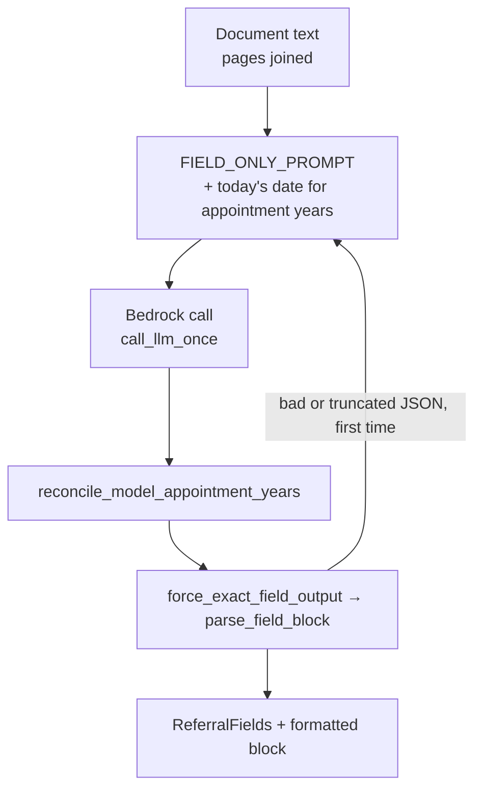

# Shared `AI/` modules

**Summary.** `AI/` is the **one implementation** of referral extraction and its business rules. The AI PDF Reader, Final Code, CMSCustomerSearch, Subject Line Builder and Unity all import from it. Don't copy a rule from here into a process folder (`Final Code/PROCESS-MAP.md` §1). Nothing in `AI/` owns a window, except the small `*_ui.py` Streamlit helpers.

## Extraction pipeline (one model call, one retry)

- **`bedrock_core.run_reasoning`** (`AI/bedrock_core.py:222`): builds the prompt, calls the model and post-processes the answer. On malformed JSON it retries once with a "return valid complete JSON" suffix, then raises (`:236-248`). It returns `(result_text, fields, raw, seconds)`. Final Code's `live_wiring.make_extract` uses the second item.
- **Model and transport.** The default model is `openai.gpt-oss-120b` through the OpenAI-compatible Bedrock endpoint (`bedrock_core.py:13`). The native Converse transport, `bedrock_runtime.py`, defaults to `openai.gpt-oss-120b-1:0` (`:14`), and the Reader backend imports it as `core`. Key resolution: a key typed in the app, then `OPENAI_API_KEY` (`bedrock_core.py:28-44`); the Runtime variant uses `AWS_BEARER_TOKEN_BEDROCK` (`ai_fcm_bedrock_runtime.py:97-117`).
- **What the prompt asks for.** Final JSON only, with no reasoning. The model's raw text is returned to the caller, but no UI shows it.

## Post-processing inside `parse_field_block` (`AI/referral_schema.py:345`)

In call order: `clean_special_instructions` → `merge_form_fields` / `explicit_form_fields` (labelled form values, which fill only blanks and flag disagreements) → `special_evidence` → `split_claims_manager_name` → `extract_special_instructions` → `split_address` → `enforce_source_roles` → `recover_provider_identity` / `recover_provider_records` → `merge_provider_records` / `provider_summary` → `normalize_appointment` → `review_formats` → `classify`.

## Module table

| Module | Role | Key entry points |
| --- | --- | --- |
| `referral_schema.py` | **The referral contract**: field groups, required/optional/provider/derived fields, the prompt, parsing, completeness, export | `FIELD_GROUPS:21`, `REQUIRED_FIELDS:59`, `PROVIDER_FIELDS:102`, `ReferralFields:302`, `parse_field_block:345`, `completeness:502`, `export_payload:538`, `force_exact_field_output:592` |
| `bedrock_core.py` | OpenAI-compatible Bedrock client; extracting text from PDF, DOCX and TXT | `extract_document_pages:157`, `join_pages:173`, `call_llm_once:181`, `run_reasoning:222` |
| `bedrock_runtime.py` | Bedrock Runtime Converse transport for the native apps | `RuntimeClient:28`, `create_bedrock_client:78` |
| `source_evidence.py` | Recovers explicitly labelled values without crossing contact roles (claimant vs provider vs adjuster) | `explicit_form_fields:30`, `special_evidence:66`, `enforce_source_roles:167` |
| `field_review.py` | Non-blocking review metadata: AI-vs-form disagreement and format flags (FCM-1.1-81–83) | `merge_form_fields:64`, `review_formats:93` |
| `document_sections.py` | Keeps Special Instructions verbatim across page breaks | `extract_special_instructions:36` |
| `provider_evidence.py`, `provider_records.py` | Provider records: recover from labels, merge compatible mentions, never invent a second provider | `recover_provider_records:80`, `merge_provider_records:76`, `provider_display_name:32` |
| `appointment_rules.py` | Appointment parsing, the year rule, past-date and holiday checks, runner confirmation | `normalize_appointment:59`, `reconcile_model_appointment_years:77`, `appointment_checks:140`, `confirm_appointments:176` |
| `address_normalization.py`, `address_enrichment.py` | Splitting addresses; explicit, reviewable US Census lookup. Never guesses an absent street | `split_address:17`, `suggest_addresses:62`, `apply_suggestions:118` |
| `injury_classification.py` | Maps free text to the RRS Body Part / Injury Type / Injury Cause dropdown values. SLB re-exports it | `resolve_body_part:69`, `resolve_cause:232`, `match_item:274` |
| `daily_output.py` | Daily Excel interchange (`Output/AI/` or `FCM_AI_OUTPUT_DIR`), read by CMSCustomerSearch | `output_directory:41`, `save_daily_output:88`, `read_record:217`, `reopen_input:249` |
| `referral_json.py` | **One JSON file per referral**: whitelisted, atomic, full source text kept by owner decision, credentials redacted | `ReferralRecord`; directory resolution `_directory:138` |
| `inference_settings.py` | Output-token budget and truncation check | `check_output_limit:7` |
| `referral_attachments.py` | Metadata-only validation of a selected referral document | `referral_document:8` |
| `rrs_assignment.py` | **RRS Complete Assignment** (option 19 + Unity case lookup + Case Id), used by Unity | `confirm_unity_login:5`, `complete_assignment:35` |
| `unity_browser.py`, `unity_completion.py`, `unity_ncm.py`, `unity_errors.py` | Unity Chrome session, the Complete Task click, post-approval NCM assignment, value-free error types | `UnityBrowserSession:8`, `complete_task:57`, `assign_ncm:91` |
| `export_rrs_dropdowns.py` | One-off capture of the live RRS dropdown lists | `capture:29` |
| `batch_samples.py` | Sample-PDF regression runner (uses `Samples for AI/`, which is sensitive) | `run_samples:233` |
| `ai_fcm_bedrock.py`, `ai_fcm_bedrock_runtime.py`, `launch_bedrock.py`, `*_ui.py` | Older Streamlit and Tk reader UIs; see [[code/ai-pdf-reader]] | — |

## Where the per-referral JSON goes (`AI/referral_json.py:126-156`)

1. If `FCM_REFERRALS_DIR` is set (Final Code also accepts `FCM_FINAL_CODE_AUDIT_DIR`), use it. It must be absolute and outside any Git worktree.
2. A frozen EXE uses a `Referrals` folder next to the EXE, unless that folder is inside a Git worktree.
3. Otherwise, for example a source run, it falls back to `%LOCALAPPDATA%/FCM_Structured/<app>/Referrals`.

Treat these files as PHI: they hold the full captured text. Retention isn't decided yet (FCM-1.1-46).

## Rules worth remembering

- `Not found` is the model's "absent" value. Convert it to `""` before legacy truthiness checks (`Final Code/finalcode/field_adapter.py:91`).
- `completeness()` returns `Passed` or `Failed`. Final Code continues only on `Passed`. A green gate checks that fields are present, not that their formats are valid.
- Section-reader evidence may only fill blanks or raise a flag. It must never overwrite a model value (the fix in FCM-1.1-81).

## Related

[[code/ai-pdf-reader]] · [[code/final-code]] · [[code/data-contracts]] · [[code/testing]]

## Open questions

- Retention and expiry for per-referral JSON (FCM-1.1-46).
- Live viewer-text coverage (all pages captured?) is not proven. See the parked extraction diagnostic in [[INSTRUCTIONS]].
