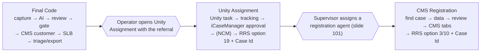

# Architecture: the business flow mapped to code

**Summary.** The BRD describes one Liberty Mutual intake-to-registration flow ([[brd/INDEX]]). In code it is split across **three operator-started desktop apps that run in sequence**:

1. **Final Code** runs RRS capture through Complete Triage / Unity Entry export.
2. **Unity Assignment** runs the Unity task, tracking, the iCaseManager approval and RRS Complete Assignment.
3. **CMS Registration** runs CMS case setup and RRS Complete Registration.

No app calls the next one. A human step sits between each pair.

## Phase → app → code

| BRD phase (slides) | Runs in | Main code |
| --- | --- | --- |
| RRS intake and iCase (5–16) | Final Code **CAPTURE**: reads the viewer text, doesn't parse it | `Final Code/finalcode/rrs_capture.py:22` |
| *(no BRD phase: AI extraction replaces the legacy regex parser)* | Final Code **EXTRACT**, or the standalone AI PDF Reader | `AI/bedrock_core.py:222` `run_reasoning`; [[code/ai-shared-modules]] |
| Operator review | Final Code **REVIEW** (blocking) and **GATE** (completeness) | `Final Code/finalcode/orchestrator.py:84-96`; `AI/referral_schema.py:502` |
| CMS re-open check and customer search (17–18) | Final Code **CMS**, or the standalone CMSCustomerSearch | `Processes/Reopen-Check/Deploy-Ready/reopen_flow.py:8`; [[code/cms-customer-search]] |
| Provider information check (19–21) | Inside Subject Line Builder provider search | `Processes/SubjectLineBuilder/Deploy-Ready/provider_match.py`, `legacy_googlesearch.py` |
| Subject Line Builder (22–64) | Final Code **SUBJECT LINE BUILDER**, or the standalone SubjectLineBuilder | `Processes/SubjectLineBuilder/Deploy-Ready/subject_line_flow.py:41`; [[code/subject-line-builder]] |
| Complete Triage and Unity export (65–68) | The tail of Final Code's SUBJECT LINE BUILDER stage | `Processes/SubjectLineBuilder/Deploy-Ready/rrs_ui.py` `RRSAdapter.complete_triage` |
| Unity intervention and task completion (69–93) | **Unity Assignment** EXE | `Processes/Unity/Deploy-Ready/unity_flow.py:35` → `legacy_unity.validate_and_complete_task`; [[code/unity-assignment]] |
| Advance notice and assignment (94–101) | **Unity Assignment**: tracking, iCaseManager gate, NCM, option 19 + Case Id | `AI/rrs_assignment.py:35`, `AI/unity_ncm.py:91` |
| CMS case setup (102–119) | **CMS Registration** EXE | `Processes/CMS-Registration/Deploy-Ready/cms_steps.py`; [[code/cms-registration]] |
| Complete Registration (120–123) | **CMS Registration**: option 3 / CEM 10 + Case Id | `cms_steps.py` `complete_registration` |
| Exceptions (124) | Not automated | — |

The slide ranges come from [[brd/INDEX]]. The advance-notice check `CheckAdvNotice` exists (`legacy_fcm.py:4144`), but its only call is commented out (`legacy_fcm.py:4142`).

## Where the apps stop, and why

- **Final Code stops before Unity.** The SUBJECT LINE BUILDER stage ends with Unity Entry export and never calls `OpenUnity`, `CompleteAssignment` or `Processes/Unity` (`Processes/SubjectLineBuilder/README.md`, "Final Code completion boundary"). Per `AGENTS.md`, don't wire Unity into Final Code without the owner.
- **Unity stops at RRS Complete Assignment.** It ends with option 19 and Case Id entry (`AI/rrs_assignment.py:58-110`). It doesn't call any CMS registration.
- **CMS Registration is sequential but decoupled.** It needs Unity's CMS case, attachment and fields to exist, but the operator starts it per claim ([[cms-registration/W1-unity-cms-connection]]).

## Data handoffs between apps (what actually moves)

| From → to | Mechanism | Evidence |
| --- | --- | --- |
| RRS → AI | Accessible text of the RRS attachment viewer (UIA `DocumentRange`), not a PDF file | `Final Code/finalcode/rrs_capture.py` |
| AI → CMS stage → SLB (Final Code) | In memory: `ReferralFields` → `cms_inputs.to_cms_inputs` → `field_adapter.to_all_data`. The CMS-resolved customer is passed on to SLB | `Final Code/finalcode/orchestrator.py:98-130` |
| AI Reader → CMSCustomerSearch | The daily Excel workbook (`Output/AI/…`), read by Record ID | `AI/daily_output.py:88,217,249`; `Processes/Reopen-Check/Stand-Alone/desktop.py:102-105` |
| Final Code → Unity | **No in-code handoff.** Unity takes its own workbook or form; its live portal step reads the attachment folder setting | `Processes/Unity/Stand-Alone/backend.py:40-60` |
| Unity → CMS Registration | **No in-code handoff.** Registration looks up the CMS case by claim number and reads the stored procedure | `cms_steps.py` `find_cases`; `CMS.py:112` |
| Every attended app → disk | One JSON file per referral (Reader, Final Code) | `AI/referral_json.py` |

## The legacy monolith for comparison

The original CustomTkinter app ran everything through one function chain: `src/fcm_intake/app.py` → `runners/fcm.py::run_fcm` → `legacy_fcm.main()`. That calls `CreateSubjectLineBuilder` → `CompleteTriageAndExportAttachment` → `OpenUnity` → an approval pause → `CompleteAssignment` (`legacy_fcm.py:4193-4210`). The legacy CMS registration path (`CMS.run_case`) was never called from it. See [[code/legacy-code]].

## Related

[[code/CODE-MAP]] · [[FINAL-CODE-FLOW]] · [[code/data-contracts]] · [[cms-registration/INVESTIGATION]]

## Open questions

- How does the referral reach Unity Assignment in practice: an operator workbook, or the attachment folder only? The owner hasn't documented the attachment-folder exclusivity rule (see `Processes/Unity/README.md`).
- Should `CheckAdvNotice` (BRD 94–96) be restored? It is commented out today.
