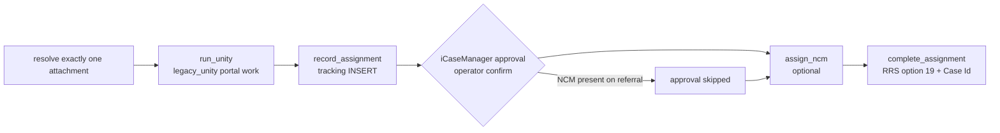

# Unity Assignment (`Processes/Unity`)

**Summary.** This process runs after Complete Triage. It works the referral's task in the **Unity** portal: customer and employer defined fields, flags, Complete Task. It then writes the **tracking** row, waits for **iCaseManager approval**, optionally assigns the **NCM**, and finishes with **RRS Complete Assignment**: option `19`, a Unity case lookup and Case Id entry. It ships as `UnityAssignment.exe`, which the operator starts on its own. Final Code never calls it. BRD: [[brd/08-unity]], [[brd/09-advance-notice-and-assignment]]. The contributor maintains it actively, with frequent releases.

## Controller

`run_flow(data, *, list_attachments, run_unity, record_assignment, notify, confirm, complete_assignment, stage="all", record_attempt_on_failure=True, nurse_case_manager_present=False, assign_ncm_after_approval=False, assign_ncm=None)` at `Processes/Unity/Deploy-Ready/unity_flow.py:35`.

- `stage`: `all` | `unity` (attachment → Unity → tracking) | `assign` (approval → completion; relies on earlier Unity work).
- Required inputs: `customer`, `claimantFirst`, `claimantLast`, `claimNumber` for all/unity; `claimNumber` only for assign. Blank values raise `ValueError` before any side effect.
- Stops: `attachment_missing`, `attachment_ambiguous`, `icasemanager_declined`. Failures: `<step>_failed`, with a value-free `{stage, type, message}`. `SystemExit` is caught as well. The original Unity error is kept even if tracking then fails too.

## Live pieces

| Step | Code |
| --- | --- |
| Unity portal | `src/fcm_intake/legacy/legacy_unity.py:329` `validate_and_complete_task` (`fill_customer_defined_fields:177`, `fill_employer_defined_fields:236`, `flag_missing_appointment_time:140`, `LMContinentalTire:134`). Complete Task: `AI/unity_completion.py:57` (one exact-label target, one click) |
| Browser | Chrome through `AI/unity_browser.py` (`UnityBrowserSession:8`). **One browser per All run**, from the portal through the case lookup |
| Tracking | `legacy_fcm.InsertIntoTable` (`legacy_fcm.py:4100`): a parameterized INSERT into the assignment log, over `FCM_RRS_DB_CONNECTION`. No automatic retry |
| NCM (v1.0.13) | `AI/unity_ncm.py:91` `assign_ncm`, run on the borrowed, already-authenticated driver, with identity and selection checks |
| RRS Complete Assignment | `AI/rrs_assignment.py:35` `complete_assignment`: `btnAssign` → input `19` → optional `Unity Complete ?` → `CMS.CheckCaseUnity(claim)` (Unity case lookup, latest valid assigned date) → **Case Id** with exact readback → OK |

The meaning of `19` isn't documented anywhere in the code. Don't label it a queue or status code without the RRS owner (`Processes/Unity/README.md`).

## Stand-alone app (`Processes/Unity/Stand-Alone/`)

| File | Role |
| --- | --- |
| `run.py` | CLI: an offline scenario by default, `--all-scenarios`, `--self-test --report PATH`, `--desktop`, `--live` |
| `backend.py` | `UnityAPI` pywebview bridge; `live_callbacks:40` wires the legacy portal, tracking and completion, with automation on a COM worker |
| `unity_model.py` | Desktop input contract: 39 legacy context keys, 35 operator columns (`schema:54`, `validate:88`, `to_controller:152`) |
| `unity_excel.py`, `Unity-Input.xlsx` | Workbook contract: one referral and one provider per row, text identifiers, formulas rejected |
| `frontend/` | React form wired to `schema()` (`src/schema.json`) |
| `test_flow.py`, `test_unity_desktop.py`, `test_unity_ncm.py`, `smoke.py` | Synthetic tests (the desktop suite alone is about 3,300 lines) and the packaged smoke test |
| `unity_assignment.spec`, `build.ps1` | Bundles the runtime-loaded `run.py`, `unity_flow.py`, the field adapter, the legacy scripts (including `CMS.py`) and the IE driver |

EXE: `dist/UnityAssignment.exe`; tag family `unityassignment-v*`, latest **v1.0.13** (2026-10-27, NCM scenarios). GitHub's **Latest** release was `unityassignment-v1.0.13` when checked on 2026-10-28.

## Traps (from `Processes/Unity/README.md`)

- Attachment preflight counts files. It doesn't bind the later legacy glob to a document identity, so the attachment folder must be exclusive to the referral.
- A returned click on Complete Task doesn't prove the server completed the task.
- Live upload, task completion, tracking and RRS completion are **unverified live**.

## Related

[[code/architecture]] · [[code/cms-registration]] · [[code/ai-shared-modules]] · [[code/configuration]]

## Open questions

- Who claims and assigns in Unity, and who accepts in iCase? The BRD varies (slides 94 vs 97, [[brd/INDEX]]).
