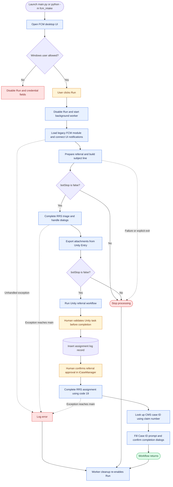
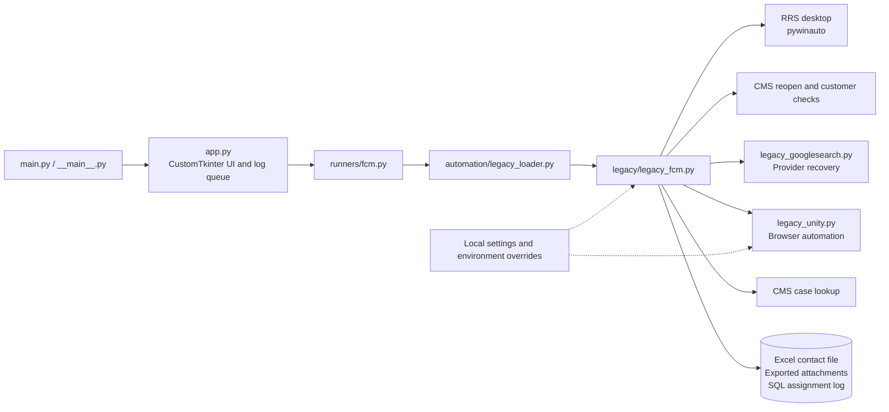

# FCM Intake V3 — Workflow Design

This document describes the current implementation. Open it in a Markdown viewer that supports Mermaid, such as GitHub, to view the flowcharts.

**Legend:** Blue = automation; amber = human review; green = completion; red = stop or error. RRS means Referral Routing System; SBL means Subject Line Builder.

## End-to-end desktop flow

The workflow processes the first RRS work-grid row. It does not contain an outer loop that automatically processes the whole queue.

## Referral preparation and decision points

```mermaid
flowchart TD
    START([CreateSubjectLineBuilder]) --> RRS[Open first RRS claimant row and Email Display]
    RRS --> PDF[Find matching referral attachment and read PDF text]
    PDF --> PARSE[Parse referral fields and save employer contact to Excel]
    PARSE --> RULES[Apply customer-specific referral rules]
    RULES --> MISSING{Required data missing?}
    MISSING -->|No| REOPEN[Search CMS for open and closed cases]
    MISSING -->|Yes| RECOVER[Attempt provider lookup and recover details]
    RECOVER --> ADDRESS{Missing provider address fields?}
    ADDRESS -->|Yes| GOOGLE[Show Google provider result picker]
    ADDRESS -->|No| VALIDATE[Validate required fields]
    GOOGLE --> VALIDATE
    VALIDATE --> VALID{Validation passes?}
    VALID -->|No| STOP([Stop for manual handling])
    VALID -->|Yes| REOPEN
    REOPEN --> SPECIAL{Goodyear or Cooper Tire with open TCM<br/>and qualifying referral type?}
    SPECIAL -->|Yes| STOP
    SPECIAL -->|No| EXISTING{Open or closed cases found?}
    EXISTING -->|Yes| REVIEW[Show case details and ask whether to proceed]
    REVIEW --> CONTINUE{User chooses Yes?}
    CONTINUE -->|No| STOP
    CONTINUE -->|Yes| CUSTOMER[Check employer in CMS and use returned name if available]
    EXISTING -->|No| CUSTOMER
    CUSTOMER --> SBL[Open Subject Line Builder and fill referral details]
    SBL --> CLAIM[Resolve claimant and like-item search results]
    CLAIM --> PROCEED{Continue after duplicate review?}
    PROCEED -->|No| STOP
    PROCEED -->|Yes| CONTACTS[Resolve provider, adjuster, and attorney details]
    CONTACTS --> MANUAL[Human selects or adds records where prompted]
    MANUAL --> FIELDS[Populate remaining injury, service, and referral fields]
    FIELDS --> FINALREVIEW[Human reviews SBL accuracy and completeness]
    FINALREVIEW --> BUILD[Click Build and close Email Display]
    BUILD --> DONE([Set botStop to false and return to triage])

    classDef auto fill:#e8f1ff,stroke:#2563eb,color:#172554;
    classDef human fill:#fff4d6,stroke:#d97706,color:#78350f;
    classDef success fill:#dcfce7,stroke:#16a34a,color:#14532d;
    classDef stop fill:#fee2e2,stroke:#dc2626,color:#7f1d1d;
    class RRS,PDF,PARSE,RULES,RECOVER,VALIDATE,REOPEN,CUSTOMER,SBL,CLAIM,CONTACTS,FIELDS,BUILD auto;
    class GOOGLE,REVIEW,MANUAL,FINALREVIEW human;
    class DONE success;
    class STOP stop;
```

Provider recovery is summarized here: cancelled, blocked, or failed Google searches can stop processing. Choosing **No Accurate Result** skips the immediate Google-result stop, but the later required-field validation can still stop the run.

## Component flow

## Current implementation notes

- Human approval is a message-box acknowledgement. The main workflow does not automatically verify iCaseManager approval before proceeding.
- The full-flow runner currently has shared CMS credential/session initialization commented out. Its log message mentions a shared session, but that initialization is not active there.
- `OpenUnity()` attempts to insert the assignment log in a `finally` block, including after a caught Unity exception. A log record alone does not prove successful assignment.
- Some legacy exceptions are printed or suppressed. The runner's “finished” message means control returned, rather than independently verified business success.
- The Bedrock extraction and sample regression tools in `AI/` are a separate workflow. The desktop path shown above reads PDF text and calls `parse_referral_pdf()`; it does not call the AI sample pipeline.

## Source map

| Stage | Implementation |
| --- | --- |
| Access control, worker, and logs | [app.py](../src/fcm_intake/app.py): `FcmBotApp`, `run_full_flow`, `_run_with_redirect` |
| Full-flow orchestration | [runners/fcm.py](../src/fcm_intake/runners/fcm.py): `run_fcm` |
| Referral parsing and preparation | [legacy_fcm.py](../src/fcm_intake/legacy/legacy_fcm.py): `OpenPDFAndCaptureData`, `parse_referral_pdf`, `CreateSubjectLineBuilder` |
| Validation | [legacy_fcm.py](../src/fcm_intake/legacy/legacy_fcm.py): `get_validation_missing`, `ValidateInfo` |
| Triage and attachment export | [legacy_fcm.py](../src/fcm_intake/legacy/legacy_fcm.py): `CompleteTriageAndExportAttachment` |
| Unity processing | [legacy_unity.py](../src/fcm_intake/legacy/legacy_unity.py): `main`, `validate_and_complete_task` |
| Assignment and overall sequence | [legacy_fcm.py](../src/fcm_intake/legacy/legacy_fcm.py): `OpenUnity`, `InsertIntoTable`, `CompleteAssignment`, `main` |
| Separate AI sample workflow | [batch_samples.py](../AI/batch_samples.py), [README.md](../README.md#ai-sample-regression-workflow) |
